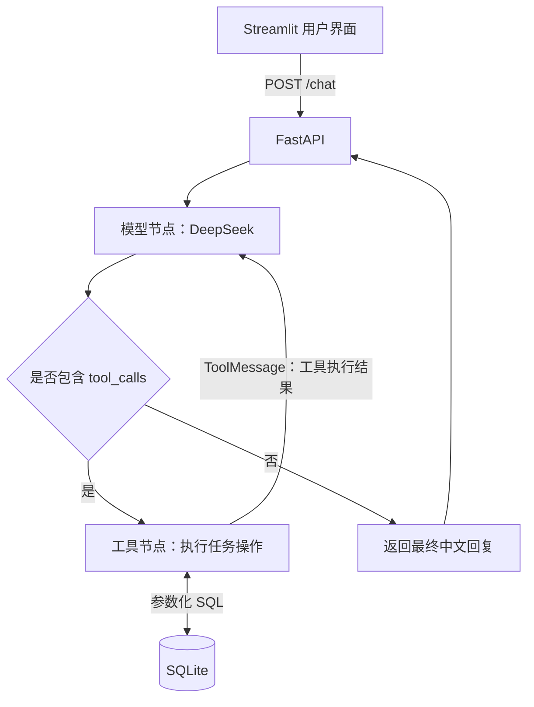

# AI 智能日程管理助手

基于 **LangGraph + DeepSeek Tool Calling** 的任务管理应用：用户用自然语言描述需求，Agent 选择并执行任务工具，将结果保存到 SQLite，再返回回复。

项目覆盖从工具定义、Agent 编排、API 封装到 Web 交互和 Docker 部署的完整链路，重点展示大模型如何从“生成回答”走向“调用工具完成操作”。

## 功能演示

| 操作 | 输入示例 | 实际行为 |
| --- | --- | --- |
| 创建任务 | 明天下午 3 点提醒我开会 | 保存任务标题与时间描述，返回任务编号 |
| 查询任务 | 我有哪些任务？ | 查询数据库中的全部任务，展示完成状态 |
| 标记完成 | 把任务 #1 标记为完成 | 按编号更新任务状态 |
| 删除任务 | 删除任务 #1 | 按编号删除任务 |

Web 界面提供自然语言输入、任务查询和按编号标记完成的入口；删除操作通过自然语言输入触发。示例中的编号需替换为实际创建的任务编号。

## 技术实现

- **工具调用，而非仅生成建议**：通过 JSON Schema 描述四个工具的名称、参数和用途，使用 `bind_tools` 交给模型选择，再通过 `TOOL_MAP` 映射到实际 Python 函数。
- **显式 Agent 控制流**：用 LangGraph 的 `StateGraph` 编排模型节点和工具节点。模型返回 `tool_calls` 时执行工具，将结果作为 `ToolMessage` 传回模型；无工具调用时结束本次请求。
- **前后端分离**：前端Streamlit 负责交互，后端FastAPI 提供 `/chat` 接口。前端通过 `API_URL` 切换本地或容器内后端地址。
- **持久化与可重建部署**：使用参数化 SQL 操作 SQLite；Docker 中将数据库放在命名数据卷，容器重新创建后仍保留任务。
- **运行配置与代码分离**：API Key、后端地址和数据库路径由环境变量配置；前后端依赖分别声明并固定直接依赖版本。

### 请求处理流程



LangGraph 管理的是单次请求内的工具调用循环。每个 `/chat` 请求都会新建消息列表，目前未接入跨请求的对话记忆或持久化 checkpoint。

### 技术栈

| 层次 | 技术 |
| --- | --- |
| Web 交互 | Streamlit、Requests |
| HTTP API | FastAPI、Pydantic、Uvicorn |
| Agent 编排 | LangGraph、LangChain 消息与工具接口 |
| 大模型 | DeepSeek `deepseek-chat`，通过 `ChatOpenAI` 调用兼容接口 |
| 数据存储 | SQLite，使用 Python 标准库 `sqlite3` |
| 部署 | Python 3.12 基础镜像、Docker、Docker Compose |

## 快速启动

需要 Docker Engine 与 Compose 插件；Windows 可使用 Docker Desktop，启动前请确保 Docker 引擎已运行。构建需要下载基础镜像和 Python 依赖，实际对话需要可用的 DeepSeek API Key、网络及 API 额度。

以下终端命令适用于 **Git Bash**，也可在具备相应工具的 Bash 环境使用。

### 1. 获取项目

```bash
git clone https://github.com/PeterG666/project2-schedule-assistant.git
cd project2-schedule-assistant
```

### 2. 配置 API Key

```bash
cp -n .env.example .env
```

用编辑器打开 `.env`，填写自己的 Key：

```dotenv
DEEPSEEK_API_KEY=your_deepseek_api_key
```

已有 `.env` 时保留原文件，只核对配置。真实 Key 不应提交到仓库；项目的 `.gitignore` 和 `.dockerignore` 已分别排除 `.env`。

### 3. 构建并运行

```bash
docker compose config --quiet
docker compose up -d --build
docker compose ps
```

`config --quiet` 检查 Compose 配置及必需变量，不输出展开后的配置。后端健康检查通过后，Compose 再启动前端。

| 入口 | 地址 |
| --- | --- |
| Web 界面 | [http://localhost:18513](http://localhost:18513) |
| Swagger 接口文档 | [http://localhost:18013/docs](http://localhost:18013/docs) |
| 后端基本响应 | [http://localhost:18013/](http://localhost:18013/) |

默认端口只绑定宿主机的 `127.0.0.1`。前端容器通过 `http://backend:8013` 访问后端；浏览器则使用上表中的宿主机地址。

> 后端 `healthy` 只代表基本 HTTP 接口可响应，不代表 DeepSeek 调用或整个任务流程已成功。请在 Web 界面实际创建并查询一条任务。

<details>
<summary>Windows 中文目录下的构建兼容处理</summary>

部分 Compose / Buildx 版本在中文项目目录下可能出现以下错误：

```text
x-docker-expose-session-sharedkey contains value with non-printable ASCII characters
```

建议克隆到英文项目目录。若保留现有中文目录，可在项目根目录的 Git Bash 中执行：

```bash
tar -cf - Dockerfile.backend requirements.backend.txt main.py | docker build -t personal-schedule-backend -f Dockerfile.backend -
tar -cf - Dockerfile.frontend requirements.frontend.txt app.py | docker build -t personal-schedule-frontend -f Dockerfile.frontend -
docker compose up -d --no-build
```

该方式从标准输入接收构建上下文，每个镜像只打包必要文件，不包含 `.env`、虚拟环境和本地数据库。两个镜像都构建成功后再执行启动命令。镜像名与当前 Compose 项目、服务的默认命名一致；若修改了 Compose 项目名，需相应调整镜像名。

</details>

## 接口示例

`POST /chat` 接收自然语言需求，返回最终回复：

```bash
curl -X POST 'http://localhost:18013/chat' \
  -H 'Content-Type: application/json' \
  -d '{"message":"创建一条任务，标题是Docker部署验收"}'
```

响应结构如下，具体文字和任务编号由实际执行结果决定：

```json
{
  "reply": "已创建任务 #1：Docker部署验收。"
}
```

也可在 Swagger 页面执行相同请求。创建、查询等 `/chat` 操作会调用真实模型 API。

## 数据与配置

| 变量 | 用途 | 默认值或 Compose 配置 |
| --- | --- | --- |
| `DEEPSEEK_API_KEY` | 后端调用 DeepSeek | Compose 启动时必填，由 `.env` 提供 |
| `API_URL` | Streamlit 请求后端的地址 | 本地默认 `http://127.0.0.1:8013`；Compose 为 `http://backend:8013` |
| `DB_PATH` | SQLite 文件路径 | 本地默认 `todo.db`；容器内为 `/data/todo.db` |

SQLite 的 `tasks` 表保存 `id`、`title`、`due_time` 和 `done`。其中 `due_time` 是文本描述，当前未进行标准化日期解析、时区换算或定时调度。

Compose 使用 `task-data` 命名卷挂载到后端的 `/data`。默认项目名下，该卷通常显示为 `personal-schedule_task-data`。宿主机原有的 `todo.db` 不会自动导入此卷，首次容器运行时任务列表可能为空。

### 本地手工验收

已完成创建任务、查询任务，以及重新创建容器后任务仍存在的手工验收。可按以下步骤复现：

1. 在 Web 界面创建一条标题为“Docker迁移验收”的任务。
2. 点击“查看我的任务”，确认任务已保存。
3. 在项目根目录执行以下命令，重新创建容器而不删除数据卷：

   ```bash
   docker compose up -d --no-build --force-recreate
   docker compose ps
   ```

4. 等待后端 `healthy`，刷新 Web 页面并再次查询；预期仍能看到同一条任务。

此验收不等于完整自动化测试覆盖。页面上的临时回复可能在刷新后消失，数据库里的任务记录应保留。

## 常用运维命令

```bash
# 查看后端日志，包含工具调用和执行结果
docker compose logs --tail 100 backend

# 暂停服务，保留容器与数据
docker compose stop

# 恢复已停止的容器
docker compose start

# 删除本项目的容器和默认网络，保留命名数据卷
docker compose down
```

`docker compose down -v` 会删除本项目声明的命名数据卷及其中的任务数据，不用于日常停止服务。日志可能包含任务内容，分享前请检查敏感信息。

## 代码结构

```text
.
├── main.py                    # FastAPI、工具定义、LangGraph 编排、SQLite 操作
├── app.py                     # Streamlit Web 界面
├── requirements.backend.txt   # 后端依赖
├── requirements.frontend.txt  # 前端依赖
├── Dockerfile.backend         # 后端镜像
├── Dockerfile.frontend        # 前端镜像
├── compose.yaml               # 服务、网络、环境变量、健康检查和数据卷
├── .env.example               # 环境变量模板，不含真实 Key
└── .dockerignore              # 排除密钥、本地数据和开发环境文件
```

## 当前边界与后续改进

- **任务管理而非通知系统**：当前不主动推送提醒；后续可增加时间解析、调度器和通知渠道。
- **单用户数据模型**：未实现登录、用户隔离或工具操作鉴权；删除操作目前也没有二次确认，尚不适合直接作为公共多用户服务。
- **对话与参数校验**：未保存跨请求上下文；工具执行层尚需完善参数校验、异常处理与超时策略。
- **测试与观测**：当前以本地手工验收为主，后续可补充工具单元测试、接口集成测试及模型调用耗时统计。

本项目的核心是验证并展示“自然语言意图 → 工具选择 → 数据操作 → 结果反馈”的工程实现，不以尚未实现的生产级能力作为项目卖点。
